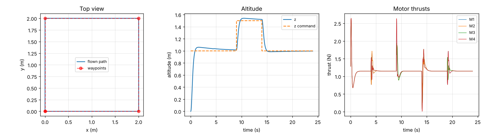
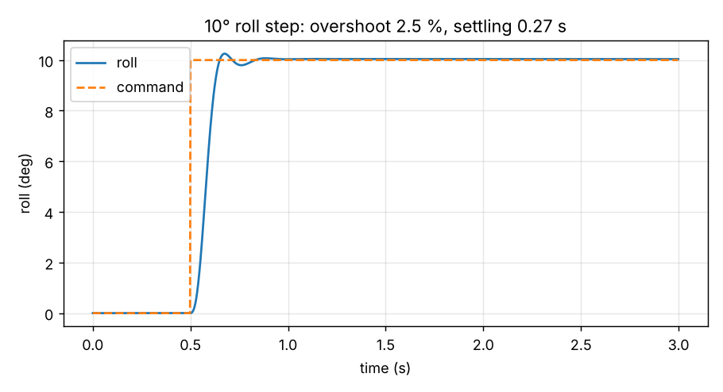
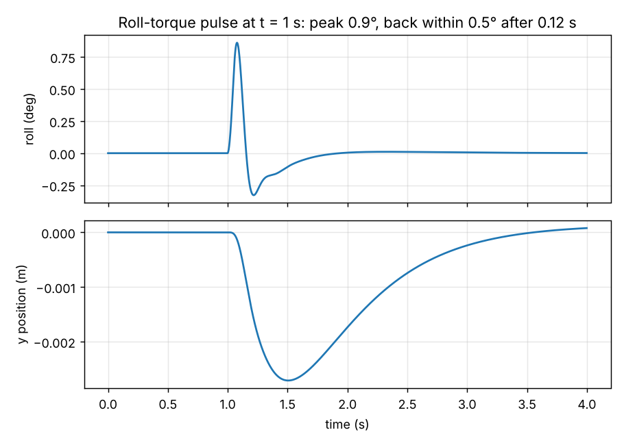

# quadcopter-pid-sim

A from-scratch 6-DOF quadcopter simulator with a cascaded PID flight controller, written in Python with NumPy. It models the rigid-body dynamics, an X-configuration motor mixer with saturation handling, and a position → attitude → motor control stack, then tests the controller with a step response, a disturbance, and a waypoint mission.

It is a simulation only: nothing here has been flown on hardware.



## What is modelled

| Part | Details |
|---|---|
| Rigid-body dynamics | 12 states (position, velocity, roll/pitch/yaw, body rates), Z-Y-X Euler angles, gyroscopic coupling `ω × Iω`, linear drag, RK4 integration at 500 Hz |
| Motors | Four motors in an X layout, first-order thrust lag (20 ms), per-motor limits 0 to 4 N |
| Mixer | Inverts the 4×4 thrust/torque map; when the request is infeasible it shifts all motors equally so **attitude torque is kept and thrust is sacrificed** |
| Controller | Position PD → desired roll/pitch → attitude PID → torques; altitude PID with tilt compensation; yaw PID |
| PID | Output clamp, integral anti-windup, derivative on measurement (no setpoint kick) |

Frames: x forward, y left, z up. All parameters (mass 0.468 kg, arm length 0.225 m, inertias, limits) are in `quadsim/params.py` and describe a generic ~0.5 kg quad, not a specific product.

## Controller structure

```
 position ref ──PD──► desired accel ──► desired roll/pitch ─┐
                                                             ├─PID─► torques ─┐
 yaw ref ───────────────────────────────────────────────────┘                │
                                                                              ├─► mixer ─► 4 motor thrusts
 altitude ref ──PID──► thrust correction + hover thrust, divided by cos(φ)cos(θ) ┘
```

The attitude gains come from a simple second-order design (`kp = ωn²·I`, `kd = 2ζωn·I`) with ωn ≈ 20 rad/s for roll/pitch, then trimmed by simulation. The torque limits are set so that roll, pitch and yaw demands together stay within what the motors can deliver near hover.

## Results

Produced by `python -m quadsim.scenarios`. Numbers below are from that run.

**Attitude step (10° roll command at t = 0.5 s)**

| Metric | Value |
|---|---|
| Overshoot | 2.5 % |
| 10–90 % rise time | 0.088 s |
| 2 % settling time | 0.27 s |
| Final error | 0.04° |



**Disturbance rejection (0.05 N·m roll-torque pulse for 50 ms while hovering)**

| Metric | Value |
|---|---|
| Peak roll deviation | 0.86° |
| Time until roll stays within 0.5° | 0.12 s |
| Maximum lateral drift | 2.7 mm |



**Waypoint mission** (take off, then fly a 2 m × 2 m square with a climb to 1.5 m on one leg)

| Metric | Value |
|---|---|
| Time to settle within 5 cm, per leg | 2.65 to 2.77 s |
| Peak tilt angle | 32.0° |
| Peak speed | 2.1 m/s |
| Yaw drift | 0.003° |
| Final position error | 3.3 mm |

The altitude loop overshoots by a few percent after the climb commands and takes several seconds to settle completely, because the integral term is slow; that tail is what dominates the per-leg settling times.

## Run it

Requires Python 3.10+.

```bash
pip install -r requirements.txt
python -m pytest -q              # 23 tests
python -m quadsim.scenarios      # prints the metrics and regenerates docs/*.png
```

Minimal example:

```python
import numpy as np
from quadsim import QuadController, QuadParams, Reference, Simulator

params = QuadParams()
sim = Simulator(params, QuadController(params),
                state0=np.array([0, 0, 1.0] + [0] * 9))
log = sim.run(8.0, lambda t: Reference(x=2.0, y=1.0, z=1.5))
print(log.state[-1, :3])         # final x, y, z
```

`Reference(roll=..., pitch=...)` bypasses the position loop and commands attitude directly, which is how the step-response test works.

## Project layout

```
quadsim/
  params.py       physical parameters
  dynamics.py     rigid-body equations of motion + RK4
  mixer.py        thrust/torque <-> motor thrusts, with desaturation
  pid.py          PID with anti-windup
  controller.py   cascaded position / attitude / altitude controller
  simulator.py    closed-loop simulation with motor lag
  scenarios.py    experiments, metrics and plots
tests/            23 pytest tests (PID, mixer, dynamics, closed loop)
docs/             generated plots
```

The tests include checks against closed-form results (free fall under RK4, hover equilibrium, `ṗ = τ/Ixx`), mixer round-trips, and end-to-end controller behaviour.

## Limitations

- The controller reads the true state; there is no sensor noise, IMU model or state estimator.
- No wind, ground contact, battery sag or propeller aerodynamics beyond linear drag and a first-order motor lag.
- Euler-angle kinematics are singular at ±90° pitch; the controller limits tilt to 30° but does not prevent flips if forced far outside that range.
- Gains are hand-tuned for this vehicle; they will not transfer to other mass/inertia values without retuning.
- Not validated against real flight data.

## Possible extensions

Add a complementary or Kalman filter for the attitude estimate, add sensor noise and loop-delay to test robustness, replace Euler angles with quaternions, or port the attitude loop to fixed-step C (the PID mirrors the one in [embedded-c-toolkit](https://github.com/kaoutar-2024/embedded-c-toolkit)).

## License

MIT, see [LICENSE](LICENSE).
